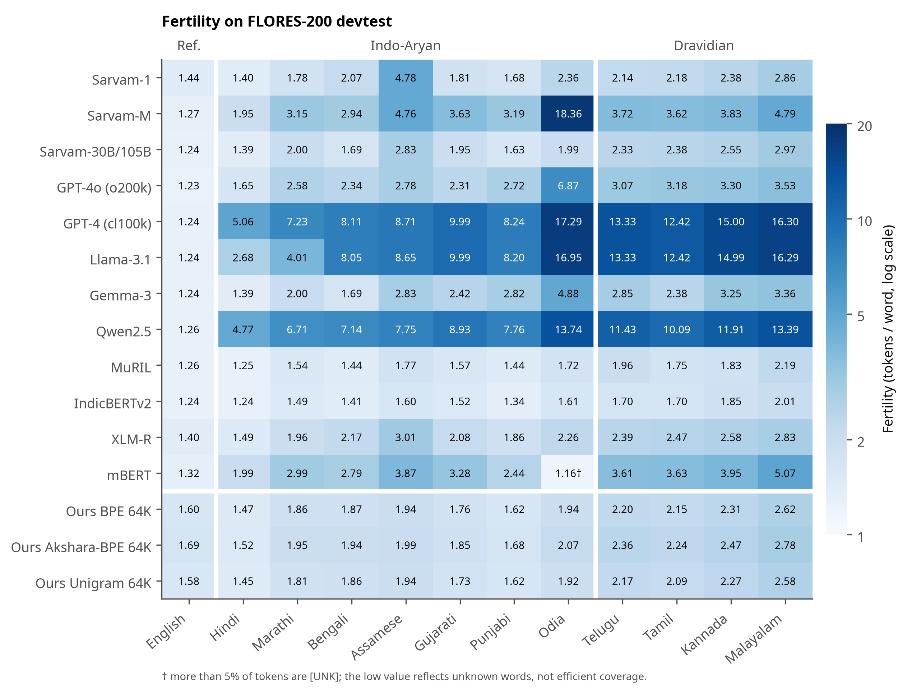
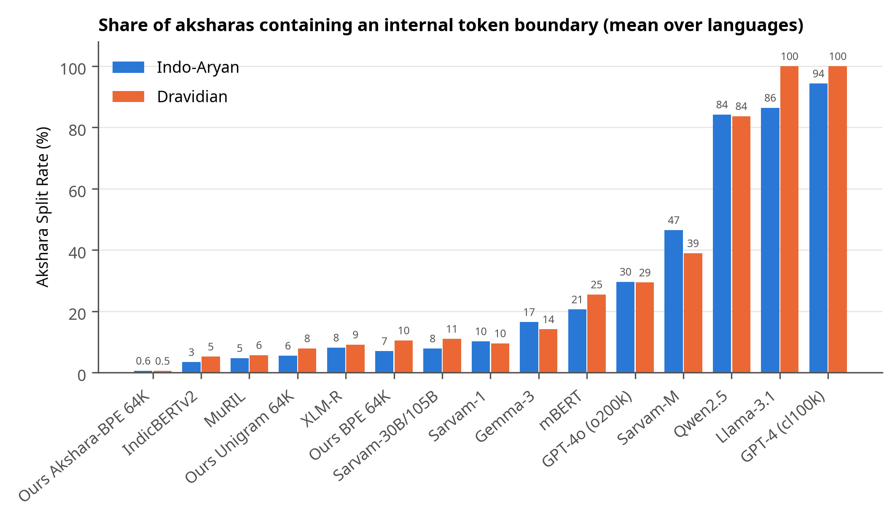
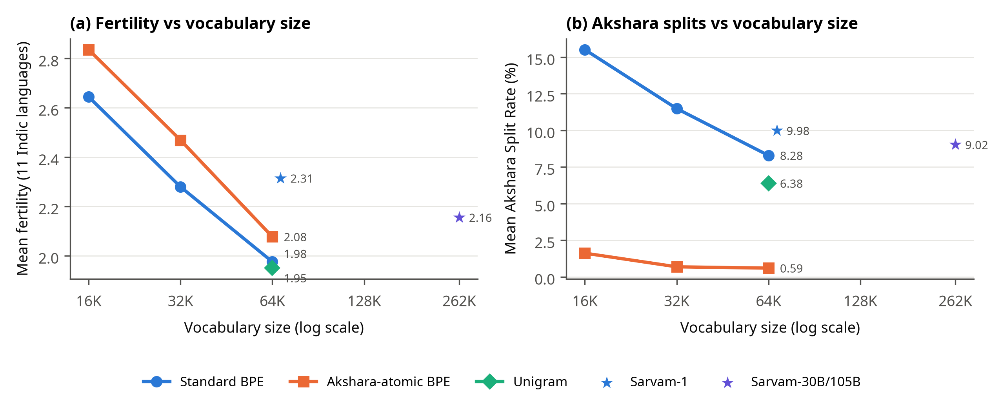
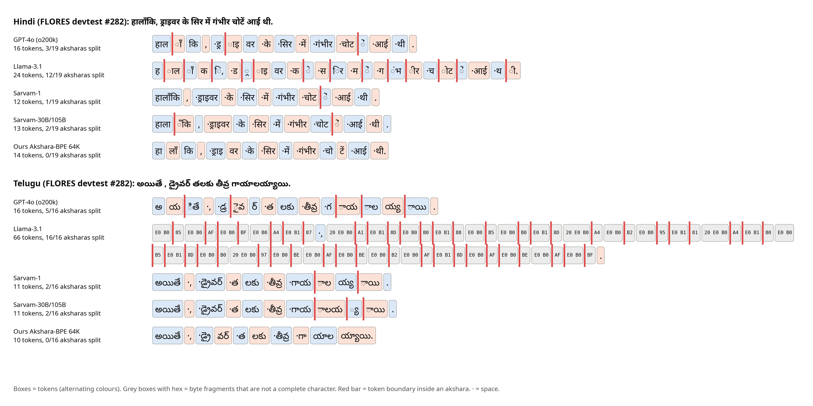

# Measuring the Indic Tokenizer Tax

**A comparative study of Sarvam AI's tokenizers and akshara-aware subword segmentation for Indian languages**
(NLP course project, Nikhileshwar Jakka, Manipal University Jaipur)

The same sentence costs very different numbers of tokens in different languages. This project measures that
"tokenizer tax" for 11 Indian languages on the parallel FLORES-200 devtest set across
12 published tokenizers, with a focus on Sarvam AI's three model generations. It recovers
exact UTF-8 byte spans for every token, which makes it possible to measure how often tokenizers break
**aksharas** (the orthographic syllables of Brahmic scripts). It also introduces **akshara-atomic BPE**, which gives
every frequent akshara its own base symbol so that BPE can never split it. Main findings:

- **Sarvam-M** reuses the Mistral-Small-3.1 vocabulary unchanged (131,072
  identical entries). **Sarvam-30B/105B** shares 91.3% of its vocabulary, with
  identical ids, with **Gemma-3**; 22,828 slots were re-assigned to Indic scripts.
- Compared with Sarvam-1, Sarvam-30B is cheaper on 5 languages but more expensive on
  6, **including all four Dravidian languages**. The Dravidian/Indo-Aryan fertility
  ratio grows from 1.05 to 1.32.
- Byte-level tokenizers break almost every akshara (Llama-3.1: 91.4%). At 64K,
  **akshara-atomic BPE** cuts the Akshara Split Rate from 8.3% to
  0.6% for a 5.1% fertility cost.

## Key results (FLORES-200 devtest; IA = Indo-Aryan, Dr = Dravidian; means over languages)

| Tokenizer | Vocab | Fertility IA | Fertility Dr | Parity IA | Parity Dr | ASR IA (%) | ASR Dr (%) |
|---|---:|---:|---:|---:|---:|---:|---:|
| Sarvam-1 | 68,096 | 2.27 | 2.39 | 1.50 | 1.22 | 10.2 | 9.6 |
| Sarvam-M | 131,072 | 5.43 | 3.99 | 3.98 | 2.30 | 46.5 | 38.9 |
| Sarvam-30B/105B | 262,144 | 1.93 | 2.56 | 1.49 | 1.52 | 7.9 | 11.0 |
| GPT-4o (o200k) | 200,019 | 3.04 | 3.27 | 2.35 | 1.96 | 29.7 | 29.4 |
| GPT-4 (cl100k) | 100,277 | 9.23 | 14.26 | 7.10 | 8.43 | 94.3 | 100.0 |
| Llama-3.1 | 128,256 | 8.36 | 14.26 | 6.41 | 8.43 | 86.4 | 100.0 |
| Gemma-3 | 262,145 | 2.58 | 2.96 | 2.00 | 1.76 | 16.5 | 14.1 |
| Qwen2.5 | 151,665 | 8.11 | 11.70 | 6.17 | 6.81 | 84.2 | 83.7 |
| MuRIL | 197,258 | 1.53 | 1.93 | 1.18 | 1.13 | 4.7 | 5.7 |
| IndicBERTv2 | 250,000 | 1.46 | 1.81 | 1.14 | 1.08 | 3.4 | 5.2 |
| XLM-R | 250,002 | 2.12 | 2.57 | 1.45 | 1.35 | 8.2 | 9.1 |
| mBERT | 119,547 | 2.65 | 4.07 | 1.93 | 2.26 | 20.6 | 25.5 |
| Ours BPE 64K | 64,000 | 1.78 | 2.32 | 1.07 | 1.07 | 7.0 | 10.5 |
| **Ours Akshara-BPE 64K** | 64,000 | 1.86 | 2.46 | 1.06 | 1.07 | 0.6 | 0.5 |
| Ours Unigram 64K | 64,000 | 1.76 | 2.28 | 1.07 | 1.06 | 5.5 | 7.9 |

Fertility = tokens per whitespace word. Parity = tokens relative to the parallel English sentences (the API cost
multiplier). ASR = Akshara Split Rate, the % of aksharas that contain a token boundary. Full per-language results with
95% bootstrap CIs: [`results/benchmark_summary.csv`](results/benchmark_summary.csv).

| Fertility | Akshara splits | Akshara-atomic BPE |
|---|---|---|
|  |  |  |



## Reproduce

Everything runs on a CPU laptop (about 15 minutes, plus downloads). Only tokenizer files are downloaded, never model
weights, and no Hugging Face login is needed.

```bash
bash scripts/run_all.sh          # Git Bash / Linux / macOS
```
```powershell
powershell -ExecutionPolicy Bypass -File scripts/run_all.ps1   # Windows PowerShell
```

This downloads FLORES-200 and fonts, streams the Sangraha training corpus, trains our tokenizers, computes every
metric and statistic, and redraws all figures. Afterwards:

- `python src/report_numbers.py` regenerates every number used by the paper, report and slides
- `python scripts/build_paper.py` builds `paper/main.pdf` (needs [tectonic](https://tectonic-typesetting.github.io)) and `paper/overleaf.zip`
- `python scripts/build_report.py` and `python scripts/build_slides.py` rebuild the report and slides
- `pytest` runs the akshara, metric and round-trip tests

`python scripts/show_results.py [summary|lineage|sarvam|family|ours]` prints the headline results, and
`python scripts/make_screenshots.py` saves the real output of the tests, the consistency check and those
result tables as images in [`screenshots/`](screenshots/).

Library versions, seeds, dataset sources, sentence counts and tokenizer revisions are logged in
[`results/run_metadata.json`](results/run_metadata.json).

## Repository map

```
src/
  config.py            languages, paths, seeds
  data.py              FLORES loader; Sangraha streaming, dedup, eval-overlap removal
  tokenizers_zoo.py    common interface + byte-span adapters (tiktoken, byte-level BPE, SentencePiece, WordPiece)
  akshara.py           akshara segmenter (grapheme clusters + virama joining, per-script rules)
  metrics.py           fertility, parity, ASR, PCW, intra-char splits, effective context, Renyi efficiency
  stats.py             bootstrap CIs, paired Wilcoxon tests, Holm correction
  vocab_analysis.py    vocabulary script composition + Sarvam lineage comparison
  train_tokenizers.py  standard BPE, akshara-atomic BPE, Unigram (SentencePiece)
  plots.py             figures (300 dpi PNG + PDF)
  report_numbers.py    single source of truth for every quoted number
  metadata.py          run_metadata.json + mirror verification
scripts/               run_all.sh / run_all.ps1, paper/report/slides builders
tests/                 pytest: akshara segmentation, metrics, round-trip
models/                our trained tokenizers (+ akshara mapping tables)
results/               CSV + JSON results
figures/               all figures
paper/                 IEEE paper (main.tex, main.pdf, overleaf.zip)
report/                university project report (.docx, .pdf)
slides/                presentation (.pptx, .pdf)
```

## Notes and limitations

- `ai4bharat/IN22-Gen` is gated on the Hugging Face Hub, so FLORES-200 is the only benchmark.
- Llama-3.1 and Gemma-3 tokenizers come from public mirrors (`unsloth/*`). The Llama-3.1 vocabulary matches Meta's
  official `llama-models` tokenizer file token-for-token, and the Gemma-3 files have the same git blob hashes as
  Google's repository (see `results/run_metadata.json`).
- mBERT maps 85.8% of Odia tokens to `[UNK]`, so its low Odia fertility is an artefact.
- All metrics are intrinsic; no language models were trained.

## Citation

```bibtex
@misc{jakka2026indictokenizertax,
  title  = {Measuring the Indic Tokenizer Tax: A Comparative Study of Sarvam AI's Tokenizers and
            Akshara-Aware Subword Segmentation for Indian Languages},
  author = {Jakka, Nikhileshwar},
  year   = {2026},
  howpublished = {\url{https://github.com/jkknikhil-git/indic-tokenizer-study}}
}
```

## Licence

Code: MIT (see [LICENSE](LICENSE)). FLORES-200 is CC BY-SA 4.0; Sangraha and the third-party tokenizers keep their
own licences. Noto fonts (downloaded, not committed) are under the SIL Open Font License.
